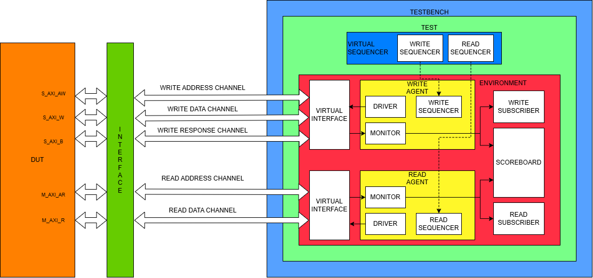
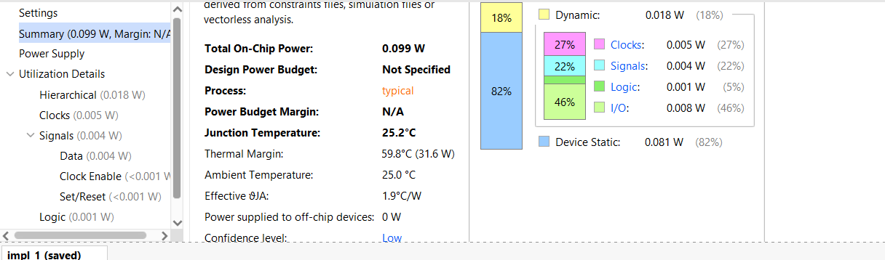
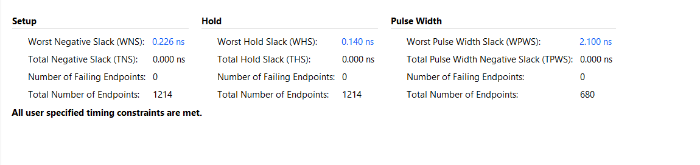
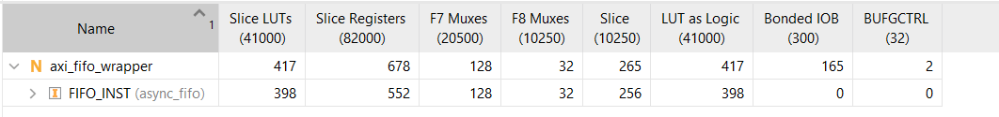

# AXI-based Asynchronous FIFO
This repository is a direct extension of the previously implemented [Asynchronous FIFO repository](https://github.com/veerx2704/async_fifo) 






This project implements an AXI wrapper over the asynchronous FIFO, aiming to achieve compatibility in a universal system. 

The file structure is as follows:
```
axi_fifo/
├── CDC_REPORTS
│   ├── _cdc_report.json
│   └── axi_fifo_output_cdc_report.json
├── Makefile
├── README.md
├── async_fifo_sta.tcl
├── axi_fifo_structure.png
├── cdc_checker.sh
├── clean_files.sh
├── design
│   ├── adder.sv
│   ├── async_fifo.sv
│   ├── axi_fifo_wrapper.sv
│   ├── fifo_memory.sv
|   ├── input_constraints.xdc
│   ├── operation_control.sv
│   └── single_flop.sv
├── design_sky130
│   ├── adder.sv
│   ├── async_fifo.sv
│   ├── axi_fifo_wrapper.sv
│   ├── fifo_memory.sv
│   ├── input_constr.xdc
│   ├── mem_macro_intf.sv
│   ├── operation_control.sv
│   └── two_flop_sync.sv
├── lut_report.png
├── power_report.png
├── results
│   ├── axi_fifo_netlist.v
│   ├── axi_fifo_output.json
│   └── fifo_netlist.v
├── synth.ys
├── synth_logs
│   ├── synthesis_report.log
│   └── timing_report.log
├── testbench
│   ├── environment.sv
│   ├── include_files.sv
│   ├── read_agent.sv
│   ├── read_driver.sv
│   ├── read_interface.sv
│   ├── read_monitor.sv
│   ├── read_sequencer.sv
│   ├── read_subscriber.sv
│   ├── read_transaction.sv
│   ├── scoreboard.sv
│   ├── sequence.sv
│   ├── test.sv
│   ├── testbench.sv
│   ├── virtual_sequencer.sv
│   ├── write_agent.sv
│   ├── write_driver.sv
│   ├── write_interface.sv
│   ├── write_monitor.sv
│   ├── write_sequencer.sv
│   ├── write_subscriber.sv
│   └── write_transaction.sv
├── timing_check.sh
├── timing_report.png
└── yosys_flow.sh
```

## Specifications
This project implements the standard AXI-4 bus protocol. It supports the main operations and signals of all 5 channels, with extensive verification through a UVM based testbench. The testbench uses constrained random stimulus with SystemVerilog Assertions.


## DESIGN

The design was synthesized using AMD Vivado 2024.2, and is on par with the baseline model with a frequency of 200MHz. The total power consumption for Kintex FPGA comes out to be 99mW. The design is lint-free and is CDC-safe has the following features:
 - Support for all 5 channels of AXI-4 base operations
 - Power consumption of 99mW at 200MHz max frequency
 - LUT utilization of   2104 cells (<1% of total)
 - Inheritant calculation for capacity of FIFO:
   - If the FIFO is partially full, and a write request is made in which the length of requested data exceeds the current capacity of the FIFO, then the request is rejected.
   - If the FIFO is partially full, and a read request is made in which length of requested data is more than the currently filled data inside the FIFO, then the request is rejected.
 - Like the FIFO, the wrapper is also asynchronous, having different clock domains for read and write.
 - The functionality of advanced signals and authentication like AxPROT, AxLOCK,AxCACHE etc. is not included in this implementation

## VERIFICATION

The verification was carried out through the open-source tools EDA playground, using Synopsys VCS simulator and UVM 1.2 library. The verification was guided by the following specifications and achieved 99.5% code coverage:

 - Majority of the data-interacting components (except scoreboard) were separated into read and write parts for verification, constrained to their respective clock domains.
 - The presence of multiple sequencers for the testbench inspired the use of a virtual sequencer to keep the verification environment coherent.
 - The virtual sequencer present in the environment navigates the read and write transaction sequences through their respective sequencers in the agent.
 - The verification was done on the following assertions:
  - All the write ready signals must be asserted at most 2 cycles after their corresponding valid signals.
  - All the read ready signals must be asserted at most 2 cycles after their corresponding valid signals.
 - The sequences were also bifurcated into read-specific and write-specific sequences. Each of these sequences is used distinctly in the tests.
 - The read and write transactions are forked to verify true asynchronousity.
 - Following tests were performed to verify the correctness of the DUT:
  - Fixed-burst equal length write and read test
  - Fixed-burst unequal length write and read test (less write)
  - Fixed-burst unequal length write and read test (less read)
  - Fixed-burst write-only test
  - Fixed-burst read-only test
  - Fixed-burst invalid address
  - Non-fixed burst
  - Fixed-burst with long singular read/write transaction (similar to direct data feeding to async fifo)

## UPDATE
The asynchronous FIFO core has been updated as similar to the original [asynchronous-fifo-repository](https://github.com/veerx2704/async_fifo)
Addition of the SRAM macro improves the maximum speed of AXI wrapper to 285MHz with a steady power of 2.66mW at all sizes of FIFO above 16 (difference of ~5 &mu;W between depth<sub>typical</sub> =16 and depth<sub>max</sub> =256).

In addition to improvement in the design, an improvement in automation has also been realized. Synthesis, Timing evaluation and CDC checks can be done by a single makefile. The steps to use makefile are as follows:

1. **Synthesis** - Done through open-source synthesis tool Yosys

```
> make synthesis
```
 - The synthesis report will be saved at **./synth_logs/synthesis_report.log**
 - The netlist will be stored at ./results as both **.v** and **.json**

2. **Power and Timing Evaluation** - Done through open-source sta tool OpenSTA and the netlist generated by Yosys.

```
make tpower
```
 - The timing and power report will be saved at **./synth_logs/timing_report.log**

3. **CDC Check** - Done through open-source tool rtl-buddy-cdc and the json netlist generated from Yosys. When running for the first time for a design, the following commands can be used:

When you already have a netlist and want it to be evaluated for CDC:

```
make cdc_check \
  NETLIST=your_netlist.json \
  NETLIST_DIR=/path/to/netlist \
  CONSTR=constraint_file.<xdc|sdc> \
  CONSTR_DIR=/path/to/constraints \     
  CDC_OUTPUT=cdc_report.json            (optional: Will be named your_netlist_cdc_report.json by default)
```

When you want rtl-buddy-cdc to run the synthesis from pre-formatted commands and use the generated netlist to check cdc:

```
make cdc_check \
  -DESIGN_TOP=top_module
  -DESIGN_DIR=/path/to/design-files
  -CONSTR=constraints.<xdc|sdc>
  -CONSTR_DIR=/path/to/constraints       (Optional: Will be defaulted to DESIGN_DIR if not mentioned)
  -CDC_OUTPUT=cdc_report.json            (Optional: Will be defaulted to DESIGN_TOP_cdc_report.json)
```

The CDC reports are stored at CDC_REPORTS which is at the same level as netlist directory or design directory.

Once a design has been checked for cdc, there is no need to specify all the commands again, as they are stored at config.mk and automatically loaded in the makefile.

**Note**: If CDC check is to be done again, but through different option from the previous run, `make clean` must be used.

4. **Cleanup** - To keep the working directory clean, use

```
make clean
```